# Forge + SubLLM + Polycell: paczki z jednym plikiem implementacji

Implementacja adaptera znajduje się w Polycell. Korzysta z przypiętych wheels lokalnego
`heyasa/forge` i jego `subactor-subllm==1.14.0+forge.1`; nie zmienia checkoutu Forge.

## Podział odpowiedzialności

```mermaid
flowchart LR
  C[Kontrakt + typy + przykłady + golden] --> P[Mały prompt Polycell]
  P --> F[Forge SubLLMProvider]
  F --> S[SubLLM: routing + HTTP + audit + usage]
  S --> L[Model lokalny]
  L --> K[Cały nowy plik komórki]
  K --> M[Kontroler: nagłówek URN/hash + manifest]
  M --> Q[Docker bez sieci + Forge run_bounded + oracle Polycell]
  Q --> G[Paczka Git / git bundle]
  G --> A[Assembly + cellset.lock.json]
  A --> T[make check + parity + testql]
```



Reużywane są rzeczywiste `forge_base.subllm_adapter.SubLLMProvider`,
`forge_base.sandbox.run_bounded` i natywny audyt SubLLM. Nie zastępujemy tych
bibliotek własnymi atrapami. Nie korzystamy natomiast z `Forge.Manager.validate`:
jego oracle i ABI dotyczą obecnego harnessu analizy grafów, a nie dowolnej komórki
Python/TS/Rust. Odbiór komórki należy do testów Polycell.

Forge wymaga JSON-a `{harness_py,kernel_rs,files,rationale}`. Adapter wymaga
niezmiennych dwóch pól sterujących i dokładnie jednego pliku `generated/cell.<ext>`.
Tylko ten plik trafia do paczki; dwa pola sterujące nie są wykonywane ani publikowane
jako dodatkowe implementacje. Model nie może dołączyć helperów czy własnego runnera.

## Format `wellmanifest.polycell.package/v1`

```text
shipping-cost/                  # może być osobnym repozytorium Git
├── cell.py                     # JEDYNY plik implementacji (alternatywnie .ts / .rs)
├── contract.cell.yaml          # źródło interfejsu i reguł zachowania
├── cases.json                  # przykłady + golden
├── input.schema.json
├── output.schema.json
├── types.txt                   # wygenerowane typy jako artefakt, nie osobny moduł
├── prompt.md                   # kontekst do regeneracji całego pliku
├── package.json                # URN, język, hash interfejsu, pełne SHA-256 plików
├── README.md
└── provider.json               # opcjonalna metryka rzeczywistej generacji/replay
```

Schemat: [polycell-package.schema.v1.json](../standard/polycell-package.schema.v1.json).
Katalog może zawierać `.git/`; liczymy pliki paczki, nie wewnętrzne pliki Git.
Paczka wymaga współdzielonego runtime Polycell — nie jest samodzielnym programem.
Nie zawiera hostów, gatewaya, Dockerfile, zależności npm/pip ani kompilatora.

`verify` sprawdza integralność, schemat kontraktu, nagłówek i wybrane wzorce I/O.
Schematy wejścia/wyjścia muszą odpowiadać kontraktowi; paczka nie może osłabić
walidacji własnym schematem. Testy zachowują wszystkie przykłady kontraktu,
mają zgodne URN/język i unikalne nazwy. Typy kontraktu muszą być samowystarczalne.
`qualify --oracle ...` dodatkowo porównuje niezmienność kontraktu/testów/typów/promptu
z osobno wskazaną, zaufaną bazą i wykonuje kod w kontenerze. Prawidłowy JSON ani hash
nie stanowią odbioru funkcji. Hash jest kontrolą integralności, nie podpisem autora.
Kwalifikacja tworzy prywatne kopie paczki i bazy bez katalogów `.git`. Raport wskazuje
hashe tych kopii, więc edycja oryginału podczas testów nie zmienia tożsamości wyniku.

Kontroler nadaje pierwszą linię URN/hash. Może dodać brakujący nagłówek lub poprawić
nazwę znacznika, ale odrzuca inną tożsamość kontraktu. Nie poprawia ciała funkcji;
cały kod zostaje wymieniony jako jeden plik i musi przejść niezależne testy.

## Instalacja i pierwsza paczka

```bash
nvm use
make install
make check
make forge-install FORGE_ROOT=/home/tom/github/heyasa/forge
make package-image FORGE_ROOT=/home/tom/github/heyasa/forge
make package CELL=shipping.cost OUT=.run/shipping

git clone .run/shipping.bundle .run/shipping-clone
.venv/bin/python tools/polycell/package.py verify .run/shipping-clone
make package-check PACKAGE=.run/shipping-clone ORACLE=.run/shipping
```

`forge-install` weryfikuje SHA-256 obu wheels według
[integrations/forge.lock.json](../integrations/forge.lock.json), a następnie instaluje
profil provider/sandbox w `.run/forge-provider`. To osobne środowisko, bez zastępowania
starszego SubLLM w środowisku semcod. Pełne API/MCP Forge nie jest częścią tego profilu.
Pierwsze zbudowanie obrazu wymaga sieci; kwalifikacja używa `--network none`, użytkownika
65534, systemu plików tylko do odczytu, limitów czasu/pamięci/CPU i braku docker.sock.

## Generacja, odbiór, jawne odtworzenie odpowiedzi

```bash
.run/forge-provider/bin/python tools/polycell/forge.py .run/shipping \
  --out .run/shipping-candidate --audit .run/shipping-audit \
  --model nvidia-coding:9b --reasoning-effort none --timeout 300

make package-check PACKAGE=.run/shipping-candidate ORACLE=.run/shipping
```

Model musi istnieć w lokalnej usłudze `http://127.0.0.1:11434`; nazwa w przykładzie
nie jest gwarancją jakości ani czasu. Ustawienia trasy i obsługiwane parametry pozostają
w SubLLM. Obecny generator profili zna trasę `heyasa/command`; adapter nie dopisuje
nieobsługiwanej `polycell/generate`. Nie przełącza się niejawnie na model w chmurze.

Audyt przechowuje pełne wejście/wyjście lokalnie. Jeśli poprawiono kontroler odbioru,
można jawnie ponownie ocenić już zarchiwizowaną odpowiedź:

```bash
.run/forge-provider/bin/python tools/polycell/forge.py .run/shipping \
  --out .run/shipping-replayed --replay-audit .run/shipping-audit
make package-check PACKAGE=.run/shipping-replayed ORACLE=.run/shipping
```

Replay sprawdza korelację natywnego audytu, dokładny prompt paczki i bazę Forge.
Oznacza `replay: true` oraz `new_inference_calls: 0`. To nie nowa generacja ani ukryty
cache odpowiedzi; nie dopisuje drugiego zużycia tokenów. Stan `outcome: success`
w metrykach providera dotyczy inferencji, a nie pozytywnego wyniku kwalifikacji.

## Składanie aplikacji i wersjonowanie

```bash
.venv/bin/python tools/polycell/package.py assemble \
  .run/customer .run/pricing .run/notify .run/shipping-candidate \
  --out .run/shop-app
cd .run/shop-app
make install
make check
make dev TS_HTTP_PORT=18102
make parity TS_HTTP_PORT=18102
make testql
make test
make integration
make chrome cdp
```

Assembly tworzy nowy katalog; nie nadpisuje działającej aplikacji. Kopiuje współdzielony
runtime, odtwarza układ `cells/<lang>/<name>` i kontrakty, a `make gen` tworzy interfejsy.
CLI publikuje katalog dopiero po generacji i kontroli zgodności. Błąd usuwa katalog
tymczasowy, umożliwiając ponowienie pod tą samą ścieżką. Konflikty współdzielonych
typów oraz nazw generowanych typów wejścia/wyjścia są odrzucane przed składaniem.
Kompozycje POA z runtime są dołączane tylko wtedy, gdy wszystkie ich URN-y występują
w paczkach. `cellset.lock.json` zapisuje dokładne commity paczek, pełne hashe manifestów
i hashe procesów. Zmiana jednej funkcji oznacza nowy commit paczki oraz aktualizację
tej zależności w aplikacji, po pełnym odbiorze. Rollback aplikacji oznacza odtworzenie
poprzedniego zestawu zależności; nie ma globalnego atomowego commita wielu repozytoriów.

Aplikacja otrzymuje trzy przenośne kontrole kontraktów, schematów i przypadków testowych.
Regresje narzędzi oraz scenariusz checkout pozostają w repo demo, ponieważ wymagają jego
konkretnych funkcji. `make integration` i `make mcp-test` odczytują rzeczywisty rejestr
oraz przykłady komórek/procesów. Działają również przy jednej komórce i braku procesów.
Zachowanie funkcji sprawdzają `make parity` i integracja, nie same kontrole strukturalne.

`make gen` tworzy `tests/generated/*.cdp.tql` na podstawie pierwszego przykładu lub golden
każdej komórki. `make cdp` wykrywa te pliki oraz własne scenariusze w `twin/scenarios`.
Przy usunięciu komórki lub procesu generator usuwa jego stare schematy i scenariusze
ze swoich katalogów wyjściowych. Kolizje nazw, plików i typów wykrywa przed zapisem.

Reguła niekompatybilnej zmiany pozostaje taka sama: nowy kontrakt i nowy major URN,
stary zostaje. Obecny generator Polycell nie obsługuje jednak dwóch majorów o tej samej
nazwie; assembly jawnie odrzuca taką kolizję. To ograniczenie do usunięcia przed
wielowersyjnym rejestrem paczek. Nie dodano centralnego serwera rejestru ani publikacji
osobnego repozytorium GitHub dla każdej komórki; istnieją lokalne repozytoria i bundles.

## Odtwarzalny test trzech języków

```bash
make package-test OUT=.run/package-acceptance
# Z wygenerowanym kandydatem shipping.cost:
make package-test OUT=.run/package-acceptance-llm CANDIDATE=.run/shipping-candidate
# W repo demo, test natywny samodzielnej kompozycji (zatrzymuje make dev tego repo):
make composition-test OUT=.run/composition-acceptance
```

Test eksportuje cztery komórki, tworzy i klonuje prawdziwe `git bundle`, kwalifikuje
Python/TS/Rust, wymaga odrzucenia celowo błędnej funkcji i składa aplikację.
Raport i paczki pozostają w podanym katalogu. `make test` uruchamia szybkie regresje
pakowania bez Dockera, modeli i lokalnego checkoutu Forge; są objęte CI.

Kwalifikacja pojedynczej paczki obejmuje stdio. Pełny parytet HTTP/gRPC/stdio jest
osobną bramką złożonej aplikacji. Samo przejście przykładów nie dowodzi poprawności
na wszystkich wejściach ani nie mierzy szybkości tworzenia dowolnej aplikacji.

Po aktualizacji ze starszego pilota wykonaj `make gen` i ponownie wyeksportuj paczki.
Poprawiono identyfikatory JSON Schema: `:v1:input` zamiast `:v1#input`, ponieważ
Draft 2020-12 nie dopuszcza niepustego fragmentu w `$id`. Zmieniają się hashe artefaktów;
URN i interfejs komórki pozostają takie same. Kandydat wymaga kwalifikacji względem
ponownie wyeksportowanej bazy. Odpowiedź modelu można jawnie odtworzyć z audytu,
jeśli jej kontekst nadal odpowiada kontraktowi.
